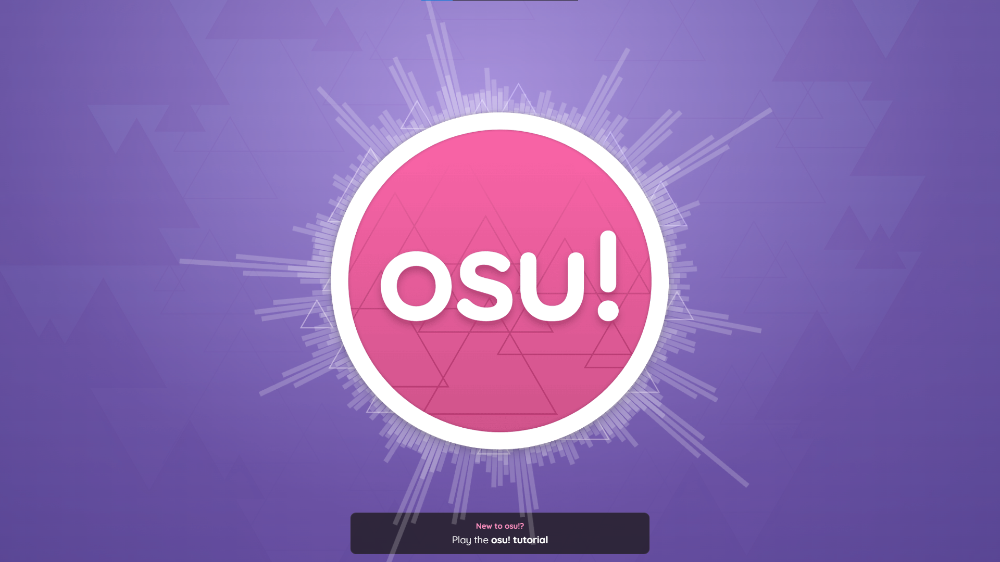
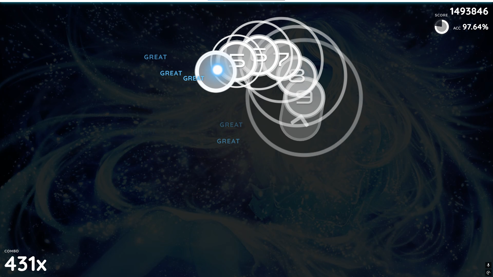
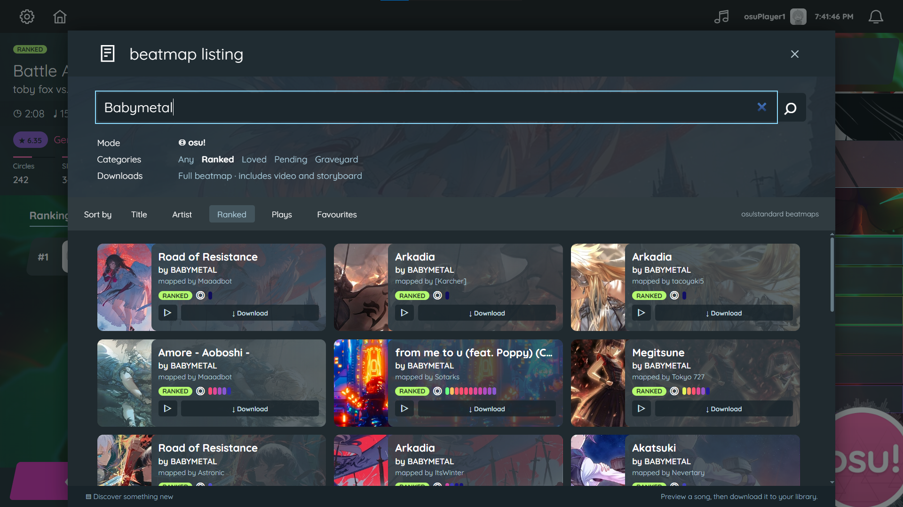
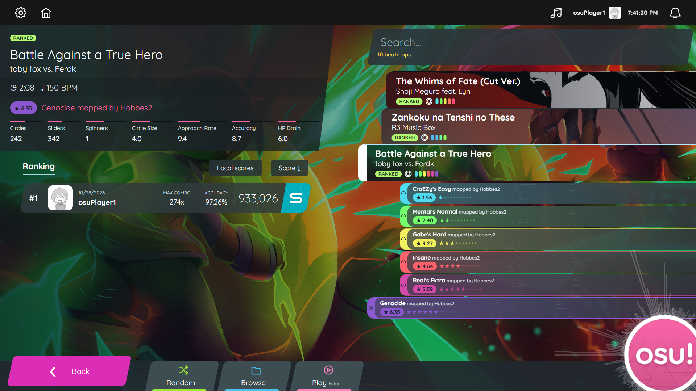
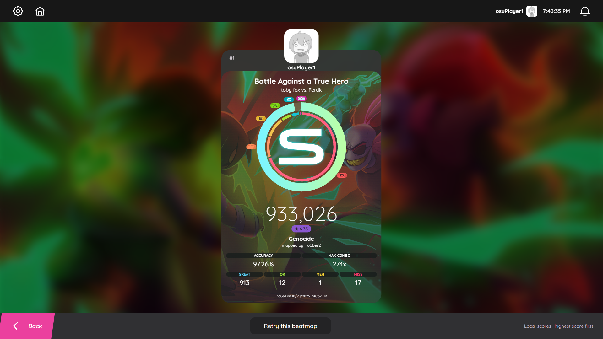
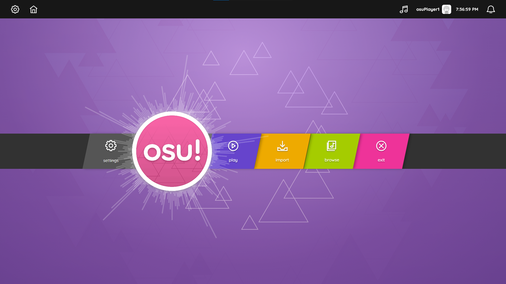

# osu! Web

**[Play online](https://xmocloud.github.io/Osu-Lazer-web/)** | [Source code on GitHub](https://github.com/XMoCloud/Osu-Lazer-web)

**osu!** is a rhythm game where you click circles to the beat of songs you like. Its standard mode also includes sliders that you hold and follow, and spinners that you move around. Community-made levels, called **beatmaps**, determine the patterns and timing for each song, with different difficulties to choose from.

This project recreates **osu!standard in the browser**, with an interface inspired by **osu!lazer**. You can play real community beatmaps, download more songs in-game, and keep track of your scores.

I originally built this for **Reboot01's Make Your Game project in Bahrain**. About a year later, I returned to improve it for **The Reboot Showroom**, from helping new players get started to making the menus move with the music.

The game runs on **HTML, CSS and vanilla JavaScript**, with a custom **DOM/SVG renderer**. No JavaScript framework or Canvas is used.



**31 starter mapsets | In-game downloads | Real .osz imports | Saved local scores**

[Get started](#get-started) | [Controls](#controls) | [Under the hood](#under-the-hood) | [Credits](#credits)

## Get started

Open **[osu! Web](https://xmocloud.github.io/Osu-Lazer-web/)** and click to start. The game is hosted on **GitHub Pages**; there is nothing to install or build to play. Use a current desktop browser with Web Audio, IndexedDB, SVG and `DecompressionStream('deflate-raw')` support.

New to osu!? Click **Play the osu! tutorial** on the main menu. It opens **new beginnings**, the original tutorial map, with storyboard instructions and voice samples. The 31 starter mapsets download in the background, with the tutorial first; you can play installed maps while the rest arrive. A persistent box at the top right shows how many maps have downloaded and confirms when the full pack is ready. You can pause downloads or retry missing maps directly from this box. Existing players also receive any new default maps they haven't installed yet.

The project is available at **[XMoCloud/Osu-Lazer-web](https://github.com/XMoCloud/Osu-Lazer-web)**. See the [deployment notes](docs/DEPLOYMENT.md) for maintaining the hosted site.

## Gameplay

Hit circles as their approach rings meet them, hold and follow sliders, and spin through spinners. Your timing determines the judgment for each hit, while consecutive successful hits build your combo.

Score, accuracy, combo and health update as you play, with hit sounds and judgments giving immediate feedback. Pause, resume, retry, breaks and fail states are all part of the game loop. Beatmap artwork and supported background videos give each song its own atmosphere.



## Beatmap browser and imports

Open **Browse** to search by song or artist, preview the music, and download a map straight into your library. Artwork, mapper names, map status and difficulty indicators help you choose. Category filters and sorting let you explore further, and downloads show progress, support cancellation, and can be retried.

Already have maps? **Import** reads original **.osz archives** and adds their playable osu!standard difficulties. The browser extracts the map data, audio and backgrounds for you. No osu! account or separate game installation is required.



Installed maps are saved in **IndexedDB**, so you don't have to import them on every visit. Ordinary starter maps skip video to reduce download time; the tutorial keeps its full archive. Browse downloads request full archives. Public mirrors supply the files, with fallbacks when a provider fails.

## Song selection

Song selection brings together cover art, coloured difficulty rows, star ratings, BPM and map statistics. Search your library, switch difficulties, or choose **Random** when you can't decide.

Arrow-key navigation keeps the selected difficulty in view, including in long mapsets. Switching songs uses short audio fades, and the music player's previous/next controls follow the map selection.



## Results and local scores

Finish a map to see your grade, score, accuracy, maximum combo and hit breakdown on an artwork-backed results card. The accuracy ring fills according to your performance, and earlier local plays appear alongside it, ordered by score.

You can compare previous attempts, retry the map, or return to the library for another song. Scores stay in your browser between visits.



## Main menu and music

The logo pulses with the music, the radial visualizer reacts to the audio, and the triangle background shifts through colours. Buttons stretch, tilt and bounce on hover, with animated transitions into song selection and gameplay.

The toolbar music player offers playback, seeking and shuffle. Scrolling on the main menu opens the master volume dial, which controls music only and defaults to 15%. Your setting is remembered for menu music, previews and gameplay tracks; hit sounds default to 30%, while menu sounds and other effects default to 50%.

**Settings ? Audio** lets you adjust music, hit sounds and other effects independently from 0?100%. Changes take effect immediately and are saved between visits. The music slider stays linked to the main-menu volume dial. **Restore defaults** returns audio to 15% music, 30% hit sounds and 50% effects, along with the other settings. Settings also save your hit keys, mouse-button preference, cursor size and sensitivity. The notification bell collects messages and running downloads, with new notifications appearing below the toolbar.



## Controls

| Action | Default control |
| --- | --- |
| Aim | Move the mouse or pen |
| Hit a circle / hold a slider | `Z` or `X`, or left/right mouse button |
| Spin | Hold a hit key or mouse button and move around the spinner |
| Pause / resume | `Esc` |
| Switch mapsets | Left / right arrow in song selection |
| Switch difficulties | Up / down arrow in song selection |
| Start the selected difficulty | `Enter` |
| Master volume | Scroll up / down on the main menu |

Open **Settings** from the gear button to change hit keys or disable mouse-button input. Custom cursor sensitivity uses Pointer Lock after a start click; `Esc` releases capture and pauses the game.

## Under the hood

A rhythm game makes small timing errors obvious. Music, input judgments, hit sounds and object animations need to agree on where the song is, even after a pause or retry. Gameplay timing follows the audio clock to keep those pieces aligned.

Rendering through page elements also makes performance a practical challenge. The engine keeps a moving window of active hit objects, rather than creating every object in a map at once. Sliders use SVG paths, including linear, Bezier and perfect-circle curves.

| Part | How it works |
| --- | --- |
| Gameplay rendering | DOM elements and SVG for circles, sliders, spinners and feedback |
| Audio | Native Web Audio for playback, gain fades, hit sounds and spectrum analysis |
| Beatmap imports | Client-side ZIP extraction and parsing of `.osu` data, music and artwork |
| Local library | IndexedDB stores maps, metadata and scores |
| Menu visualizer | An SVG path reused across five radial passes, driven by an audio analyser |
| Navigation | Menu, loading, gameplay and results share `index.html`; the engine loads on demand |

The project supports **osu!standard**. Gameplay video depends on the archive and browser codec support; the tutorial's storyboard and voice samples are supported, while arbitrary third-party storyboards have partial support. Maps and scores are stored per browser and site origin.

For implementation details and verification:

- [Testing and browser compatibility](docs/TESTING.md)
- [Design and animation references](docs/DESIGN_REFERENCES.md)
- [GitHub Pages deployment](docs/DEPLOYMENT.md)
- [Third-party notices and licences](docs/THIRD_PARTY_NOTICES.md)

The dependency-free regression suite runs with:

```sh
node --test tests/regressions.mjs
```

## Credits

This is an independent fan recreation inspired by **osu!** and **osu!lazer**.

Thanks to **[111116](https://github.com/111116)** and **[webosu](https://github.com/111116/webosu)**. A few parts of the parsing, curve mathematics and audio foundations was taken or adapted from that project.


Beatmaps, music, artwork and fonts belong to their respective creators. The screenshots above are captures of this project.
